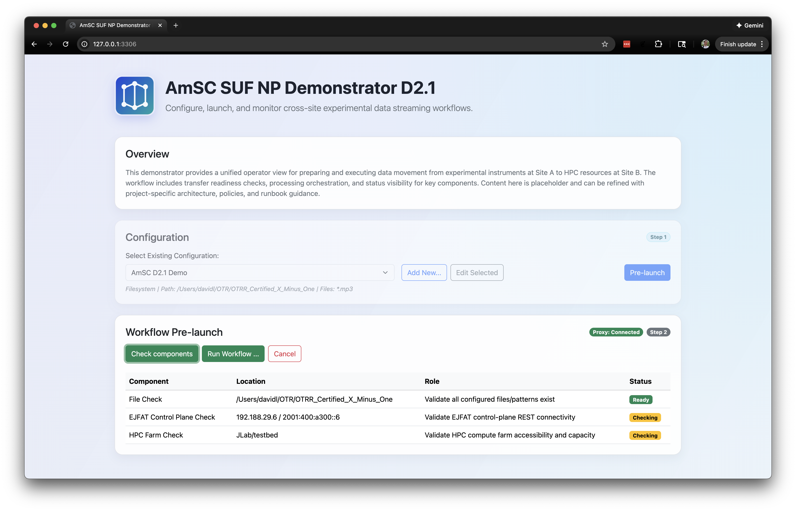
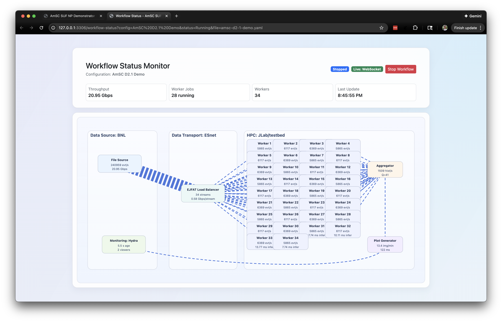

# AmSC SUF NP Demonstrator (D2)

This directory contains the SUF demonstrator materials for D2, including the D2.1 Flask-based workflow UI and simulator-backed workflow status monitor.

## Quick Start

Minimal steps to run the demonstrator locally:

~~~bash
git clone https://code.jlab.org/davidl/AmSC-SUF-IP
python3 -m venv venv
./venv/bin/python -m pip install -r AmSC-SUF-IP/SUF_D2/requirements.txt
./venv/bin/python AmSC-SUF-IP/SUF_D2/D2.1/app.py
~~~

Open browser and point to: [http://127.0.0.1:3306]()

## What You Get

The D2.1 demonstrator provides:

- A main control page for configuration, pre-launch checks, and workflow launch.
- A live workflow status page with node/link visualization and staged activity.
- A local proxy simulator that provides workflow state and live metrics over REST.

### Main Page

### Workflow Status Page

---

## Repository Layout

- `D2.1/` — Flask app, templates, static assets, and proxy simulator.
- `D2.2/` — Additional D2 artifacts.
- `requirements.txt` — Python dependencies for running the demonstrator.
- `docs/` — Screenshots referenced by this README.

---

## Running Notes

- The Flask server launches on `127.0.0.1:5001` by default.
- The proxy simulator uses `127.0.0.1:11096`.
- If the simulator is not running, start the app and use the UI controls to start/connect as needed.
- Workflow metrics and staged link activation are simulator-driven.

---

## Configuration Notes

- Saved configurations are written to a local `configurations/` folder in the launch working directory.
- File-based data source checks support wildcard expansion (through proxy-side file checking).
- Transport and HPC settings influence worker topology and monitoring behavior.

---

## Troubleshooting

- If updates do not appear in the workflow page, refresh the browser tab.
- If status appears stale, restart the simulator and relaunch the workflow.
- If dependencies fail to install, verify you are inside the activated virtual environment before running `pip install -r requirements.txt`.

